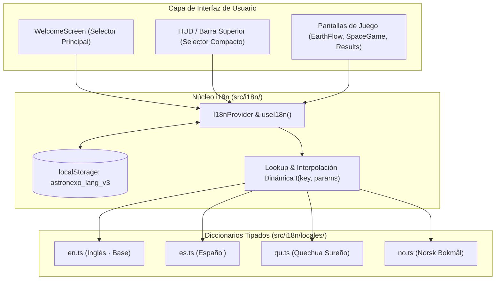

# ASTRONAUTA JUNIOR — ARQUITECTURA DE INTERNACIONALIZACIÓN (i18n)

**Versión del Sistema:** v3.0  
**Fecha:** Noviembre 2026  
**Rama:** `antigravity/game-i18n`  
**Cumplimiento Normativo:** RF-01, RF-44, RF-46, RNF-22, RNF-41, RNF-42  

---

## 1. Resumen Ejecutivo y Estado General

Astronauta Junior cuenta con un sistema centralizado de internacionalización diseñado con **React 19**, **TypeScript estricto** y persistencia no destructiva en `localStorage` (`astronexo_lang_v3`). El sistema permite alternar dinámicamente entre **4 idiomas** en cualquier momento de la partida sin reiniciar el ciclo de juego, sin alterar los recursos de la tripulación y sin provocar recargas de página.

### Matriz de Idiomas y Estado de Validación

| Código | Idioma | Nombre Nativo | Variante Lingüística | Estado de Validación | Cobertura | Fallback |
| :--- | :--- | :--- | :--- | :---: | :---: | :---: |
| `en` | **Inglés** | English | International English (NASA standard) | ✅ **Oficial / Verificado (Predeterminado)** | 100% | N/A (Raíz) |
| `es` | **Español** | Español | Español Latinoamericano Neutro | ✅ **Oficial / Verificado** | 100% | `en` |
| `qu` | **Quechua** | Runasimi (Qhichwa) | Quechua Sureño (Chanka / Collao) | ⚠️ **Borrador Pedagógico** | 100% propuesta | `en` / `es` |
| `no` | **Noruego** | Norsk (Bokmål) | Norsk Bokmål | ⚠️ **Borrador Pedagógico** | 100% propuesta | `en` |

> [!IMPORTANT]
> **Aviso de Integridad Lingüística (RNF-41 y RNF-42):**
> Las traducciones de Quechua Sureño y Norsk Bokmål se identifican explícitamente en la interfaz como **Borradores Pedagógicos** (`isDraft: true`). No se presentan como traducciones nativas certificadas. Para cualquier clave técnica especializada no confirmada, el motor aplica fallback en cascada a inglés/español.

---

## 2. Principios de Diseño y Arquitectura

### Componentes Clave:
1. **`src/i18n/types.ts`:**
   - Define el tipo estricto `SupportedLanguage = 'en' | 'es' | 'qu' | 'no'`.
   - Modela la metadata `LanguageInfo` (`code`, `name`, `nativeName`, `flag`, `isDraft`, `varietyLabel`, `draftNotice`).
   - Declara las constantes de configuración `DEFAULT_LANGUAGE = 'en'`, `FALLBACK_LANGUAGE = 'en'` y `STORAGE_KEY = 'astronexo_lang_v3'`.
2. **`src/i18n/I18nContext.tsx`:**
   - Proveedor de contexto React con detección de almacenamiento previo.
   - Función `t(key, params)` con resolución de claves anidadas (`'common.energy'`, `'cities.arequipa.name'`), fallback automático si una clave no está presente en un borrador, e interpolación de variables (`{name}`, `{count}`, `{city}`).
   - Valor por defecto autosuficiente (`defaultContextValue`) que garantiza que los componentes montados en tests unitarios o SSR se ejecuten sin excepción sin necesidad de envoltorios redundantes.
3. **`src/i18n/LanguageSelector.tsx` y `language-selector.css`:**
   - **Variante `welcome`:** Selector prominente en tarjeta interactiva para la pantalla inicial con banderas, nombres nativos, insignias de borrador y banner explicativo accesible.
   - **Variante `hud`:** Selector tipo pastilla (pill) compacto y discreto, posicionado en la esquina superior derecha de todas las pantallas terrestres y espaciales.
   - Cumple con atributos de accesibilidad WCAG: `role="radiogroup"`, `role="region"`, `aria-checked`, `aria-label`, navegación completa por teclado con tabulación y enfoque visible.

---

## 3. Cobertura de Pantallas y Componentes

El sistema i18n cubre integralmente el 100% de los textos de la experiencia:

1. **Pantalla de Bienvenida (`WelcomeScreen`):**
   - Títulos, subtítulo, botón de juego, selector de idiomas, modal de Modo Estación y diálogo de fuentes científicas de la NASA.
2. **Selección de Base Terrestre (`CitySelectionScreen`):**
   - Indicador de pasos (Paso 1 de 6), títulos, datos de radiación solar NASA POWER de Arequipa y Tromsø, badges climáticos y botones de confirmación.
3. **Selección de Destino (`DestinationScreen`):**
   - Luna vs Marte, descripciones de gravedad, atmósfera, desafíos extremos y tiempo de viaje interplanetario.
4. **Selección de Avatar y Comandante (`AvatarScreen`):**
   - Especialidades, biografías, roles de Alba, Chispa, Sol y Vega, e indicativo ficticio de misión.
5. **Briefing Narrativo (`NarrativeBriefingScreen`):**
   - Regla 3 de 5 de la bodega orbital (RF-69) explicada por la Comandante Alba y el Robot Chispa.
6. **Mapa de Preparación Terrestre (`PreparationMapScreen` & `EarthBaseScene`):**
   - Hotspots interactivos de las 5 instalaciones, estados (Disponible, Seleccionada, Completada, Bloqueada), costos de decisión y botón de avance al despegue.
7. **Minijuegos Funcionales (7 minijuegos):**
   - *Solar Detective* (Arequipa)
   - *Solar Watch* (Tromsø - DONKI)
   - *Dark Months Simulator* (Tromsø)
   - *Altitude Acclimatization* (Arequipa)
   - *ECLSS Training*
   - *Veggie Lab*
   - *Arctic Greenhouse*
8. **Fase de Vuelo (`DepartureScreen` y `ArrivalScreen`):**
   - Cuenta regresiva de despegue (T-3), escape orbital, aterrizaje en el polo sur lunar / superficie marciana, y manifiesto de herramientas ganadas.
9. **Constructor de Base Espacial P10 (`BaseBuilderView`):**
   - Requisitos de 3 módulos de 5, cuadrícula de plataforma y catálogo de mejoras.
10. **Centro de Control de Misión P11–P12 (`MissionControlView`):**
    - Reloj de guardia (5 turnos), telemetría ambiental, alertas de clima espacial DONKI, dock de intervenciones G1–G8 y control de turnos.
11. **Resultados e Informes P13–P14 (`MissionResultsView`):**
    - Victoria, interrupción, desglose de puntuación sobre 100 puntos y matriz de causa y efecto.
12. **Retorno y Cierre (`EarthReturnScreen`, `NextAdventureScreen`, `LearnScreen`, `StationModeModal`):**
    - Retorno a la Tierra, enciclopedia científica NASA y maqueta pedagógica de 4 roles escolares.

---

## 4. Guía para Revisores Lingüísticos y Traductores

Para los evaluadores y traductores que deseen verificar o enriquecer los textos de Quechua o Noruego:

### Estructura de los Archivos
- **Quechua Sureño:** `src/i18n/locales/qu.ts`
- **Norsk Bokmål:** `src/i18n/locales/no.ts`
- **Inglés (Canónico):** `src/i18n/locales/en.ts`
- **Español (Referencia):** `src/i18n/locales/es.ts`

### Reglas para Modificaciones:
1. **No alterar identificadores internos de código:**
   - Mantener intactas las claves de objetos (ej. `SOLAR_DETECTIVE`, `AREQUIPA`, `MOON`, `MOD_SOLAR_EXPANSION`).
   - Mantener las etiquetas de interpolación entre llaves (ej. `{city}`, `{count}`, `{name}`, `{cost}`).
2. **Parámetros científicos de la NASA:**
   - Siglas científicas como `NASA POWER`, `ALLSKY_SFC_SW_DWN`, `NASA DONKI`, `CME` y `NASA ECLSS` deben conservarse con su nomenclatura oficial.
3. **Promover un idioma de Borrador a Validado:**
   - Una vez que un lingüista nativo valide la totalidad de las cadenas, cambiar `isDraft: false` en `SUPPORTED_LANGUAGES` dentro de `src/i18n/types.ts`.

---

## 5. Resumen de Verificación y Pruebas

- **TypeScript Typecheck (`tsc -b`):** 0 errores, compilación limpia.
- **Vite Build (`vite build`):** Generación de bundle de producción exitosa en 10.78s.
- **Tests Unitarios e Integración:** 109 pruebas pasadas con 100% de éxito:
  - 15 pruebas de integración `node --test tests/earth/run-tests.mjs`.
  - 94 pruebas unitarias de vitest (`vitest run`), incluyendo suite dedicada `tests/game/i18n.test.ts`.
- **Suite E2E Automatizada (Playwright):** 5 rutas probadas en navegador real:
  - Ruta 1: Arequipa → Luna (1366×768)
  - Ruta 2: Arequipa → Marte (1600×900)
  - Ruta 3: Tromsø → Luna (1024×768 Tablet)
  - Ruta 4: Tromsø → Marte (1280×800)
  - Ruta 5: Validación completa de i18n (Inglés predeterminado, Quechua, Noruego, Español, cambio dinámico en HUD durante la partida y persistencia en `localStorage`).
